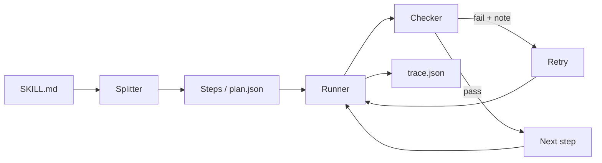

# Skill Compiler + Gemma Fail Museum

An open-source harness that makes small open models like Gemma 4 follow long agent skills (SKILL.md files) reliably, plus a published benchmark of how plain Gemma fails.

Pre-event work started with organizer approval.

Built for Hacktoberfest Hack Day x AI for Vizag, 1 Nov 2026.

## The problem

Give a small model a long skill ("do these 8 steps, in this format, under 60 words") in one prompt and it often skips a step, blends two steps, forgets an earlier result, or breaks a rule. Nothing tells you it happened.

## What it does

1. **Split**: reads a `SKILL.md` and breaks it into small ordered steps.
2. **Run**: gives the model one step at a time, with the results of the steps it depends on.
3. **Check**: tests every output (format and rules, then a second model call that answers PASS or FAIL).
4. **Retry**: on a failure, sends the checker's note back and asks again, then records everything in a `trace.json`.



## Quickstart

```
git clone https://github.com/Yasaswini-ch/skill-compiler.git
cd skill-compiler
pip install -r skillcompiler/requirements.txt flask
cp .env.example .env            # set GEMINI_API_KEY and GEMMA_MODEL (see the event page)

# split a skill into steps
python -m skillcompiler compile skillcompiler/examples/ticket-triage/SKILL.md -o plan.json

# run it through the harness
python -m skillcompiler run skillcompiler/examples/ticket-triage/SKILL.md \
  --input-file skillcompiler/examples/ticket-triage/input.txt --trace trace.json

# lint a skill (no API key needed)
python tools/lint_skill.py skillcompiler/examples/ticket-triage/SKILL.md

# benchmark (needs the benchmark/ folder)
python -m benchmark.run_compare --limit 3

# open the web pages
python web/server.py            # then visit http://127.0.0.1:5000/
```

The pages in `web/` also open straight from the folder (double-click `web/index.html`). No internet is needed.
After copying new files into `web/data/`, run `python tools/sync_web_data.py` so that folder-opened pages see them.

Tests (no API key needed): `python -m pytest skillcompiler/tests tools/tests`

## Results

Results are on **[N] tasks** with model **[MODEL]**, verifier **[ON/OFF]**.

| | Passed |
|---|---|
| Plain Gemma | [PLAIN x / y] |
| With the harness | [HARNESS x / y] |

Cost of the harness: **[X] times** the calls and **[Y] times** the time of plain (see the overhead table in `benchmark/`).

These numbers are filled in only from real runs. Anything shown with a red MOCK DATA banner is an example of the format, not a result.

## Failure labels

| Label | Meaning |
|---|---|
| `skipped_step` | A required step's output is missing. |
| `wrong_format` | Output is not in the required format. |
| `lost_track` | Later steps contradict or forget earlier steps. |
| `merged_steps` | Two steps were blended into one output. |
| `hallucinated_step` | The model added content the skill never asked for. |
| `ignored_constraint` | A limit or rule was broken (word count, required phrase, forbidden word). |
| `other` | Anything else, reviewed by hand. |

## Explore

- **Fail Museum**: `web/museum.html`, real failures grouped by label.
- **Score page**: `web/index.html`, plain vs harness.
- **Trace viewer**: `web/trace.html`, see a retry step by step.
- **Skill linter**: `tools/lint_skill.py`, tells you which skills are risky for small models.
- **Live mode**: `web/live.html`, run plain and harness side by side.
- **Dataset**: [LINK TO benchmark/dataset/] and its card [LINK TO DATASET_CARD.md].
- **Harness details**: [docs/HARNESS.md](docs/HARNESS.md).

## Contribute a failure

Found a skill where a small model goes wrong?
[Submit a failure](https://github.com/Yasaswini-ch/skill-compiler/issues/new?template=submit_failure.yml). See [CONTRIBUTING.md](CONTRIBUTING.md) to add tasks or labels.

## Limitations

- The harness costs extra API calls and time: each step takes at least one call, plus one for the verifier.
- Results are on [N] tasks. A small benchmark can mislead.
- Checks are programmatic and can be wrong. A wrong check creates a fake failure, so labels were reviewed by hand.
- The verifier is itself a small model, so it can pass a wrong answer that is well formed.
- Free API tiers are rate limited, so long runs are slow.

## License

See [LICENSE](LICENSE).
