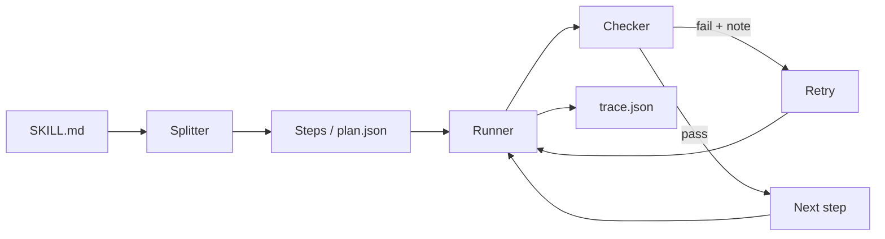

# Skill Compiler + Gemma Fail Museum

An open-source harness that makes small open models like Gemma 4 follow long agent skills (SKILL.md files) reliably, plus a published benchmark of how plain Gemma fails.

Pre-event work started with organizer approval.

Built for Hacktoberfest Hack Day x AI for Vizag, 1 Nov 2026.

## The problem

Give a small model a long skill ("do these 8 steps, in this format, under 60 words") in one prompt and it often skips a step, blends two steps, forgets an earlier result, or breaks a rule. Nothing tells you it happened.

## What it does

1. **Split**: reads a `SKILL.md` and breaks it into small ordered steps.
2. **Run**: gives the model one step at a time, with the results of the steps it depends on.
3. **Check**: tests every output (format and rules, then a second model call that answers PASS or FAIL).
4. **Retry**: on a failure, sends the checker's note back and asks again, then records everything in a `trace.json`.



## Quickstart

```
git clone https://github.com/Yasaswini-ch/skill-compiler.git
cd skill-compiler
pip install -r skillcompiler/requirements.txt flask
cp .env.example .env            # set GEMINI_API_KEY and GEMMA_MODEL (see the event page)

# split a skill into steps
python -m skillcompiler compile skillcompiler/examples/ticket-triage/SKILL.md -o plan.json

# run it through the harness
python -m skillcompiler run skillcompiler/examples/ticket-triage/SKILL.md \
  --input-file skillcompiler/examples/ticket-triage/input.txt --trace trace.json

# lint a skill (no API key needed)
python tools/lint_skill.py skillcompiler/examples/ticket-triage/SKILL.md

# benchmark (needs the benchmark/ folder)
python -m benchmark.run_compare --limit 3

# open the web pages
python web/server.py            # then visit http://127.0.0.1:5000/
```

The pages in `web/` also open straight from the folder (double-click `web/index.html`). No internet is needed.
After copying new files into `web/data/`, run `python tools/sync_web_data.py` so that folder-opened pages see them.

Tests (no API key needed): `python -m pytest skillcompiler/tests tools/tests`

## Results

Results are on **10 hand-written tasks** with model **gemma-4-26b-a4b-it** (through the Gemini API), the verifier **ON**, one official run. Two repeat runs with the same settings gave the same pass counts (`benchmark/RESULTS_NOTE.md`).

| | Passed |
|---|---|
| Plain Gemma | 7 / 10 |
| With the harness | 9 / 10 |

Cost of the harness: about **16 times** the calls (16.2 per task against 1.0) and about **14 times** the time (49.9 s per task against 3.6 s) of plain; see `benchmark/output/overhead.md`.

What changed: the harness fixed three tasks plain failed (running arithmetic across steps in t04 and t05, and a fixed table in t08). It lost one that plain passed (t03: the final step turned the text `no` into the boolean `false`). On these tasks the verifier never rejected a step, so the retry mechanism was barely exercised.

These numbers come from `benchmark/output/results.json` and nowhere else. Anything shown with a red MOCK DATA banner is an example of the format, not a result.

### Harness settings

The numbers above use the defaults. Everything below is opt-in and changes behaviour only when you set it (details in [docs/HARNESS.md](docs/HARNESS.md)).

| Variable | Default | Meaning |
|---|---|---|
| `SKILLCOMPILER_MODE` | `full` | `adaptive` skips the verifier on steps that look safe; `auto` can run a plain route for low-risk skills. Not part of the official results. |
| `SKILLCOMPILER_VERIFY` | on | Model verifier on each step. |
| `SKILLCOMPILER_COPY_RULE` | `0` | `1` adds a rule that copies a plain answer through unchanged. Mixed results; off by default. |
| `GEMMA_RPM` | `25` | Requests per minute the client allows itself. |
| `GEMMA_TIMEOUT` | `240` | Seconds before a model call is given up. |

## Failure labels

| Label | Meaning |
|---|---|
| `skipped_step` | A required step's output is missing. |
| `wrong_format` | Output is not in the required format. |
| `lost_track` | Later steps contradict or forget earlier steps. |
| `merged_steps` | Two steps were blended into one output. |
| `hallucinated_step` | The model added content the skill never asked for. |
| `ignored_constraint` | A limit or rule was broken (word count, required phrase, forbidden word). |
| `other` | Anything else, reviewed by hand. |

## Explore

- **Fail Museum**: `web/museum.html`, real failures grouped by label.
- **Score page**: `web/index.html`, plain vs harness.
- **Trace viewer**: `web/trace.html`, see a retry step by step.
- **Skill linter**: `tools/lint_skill.py`, tells you which skills are risky for small models (rules L01 to L09: too many steps, long step, similar steps, no output format, vague words, several actions in one step, nested condition, unnumbered steps, no steps found).
- **X-ray**: `web/xray.html`, watch a run step by step (live from the server, or a REPLAY of a recording). **Download report** saves one self-contained HTML proof file for any trace.
- **Break Gemma Arena**: `web/arena.html`, try to make plain Gemma fail while the harness runs beside it. Tested challenges are scored; free play is marked UNVERIFIED and never counted. Operator notes and privacy rules: [docs/ARENA_OPERATOR.md](docs/ARENA_OPERATOR.md).
- **Skill Doctor**: `web/doctor.html`, paste a skill to get the free lint score, the steps the harness would make, and a suggested rewrite (it lists numbers or quoted phrases the rewrite dropped). Add your own simple checks to try plain vs harness once each.
- **Chrome extension** (not yet checked in a real Chrome): right-click selected text and run a skill through your local server, no API key in the extension. See [extension/README.md](extension/README.md).
- **Live mode**: `web/live.html`, run plain and harness side by side.
- **Dataset**: [`benchmark/dataset/`](benchmark/dataset/) and its card [`DATASET_CARD.md`](benchmark/DATASET_CARD.md).
- **Harness details**: [docs/HARNESS.md](docs/HARNESS.md).

## Contribute a failure

Found a skill where a small model goes wrong?
[Submit a failure](https://github.com/Yasaswini-ch/skill-compiler/issues/new?template=submit_failure.yml). See [CONTRIBUTING.md](CONTRIBUTING.md) to add tasks or labels.

## Limitations

- The harness costs extra API calls and time: each step takes at least one call, plus one for the verifier.
- Results are on 10 tasks and one official run, so a gain of two tasks is within what run-to-run variation could change. A small benchmark can mislead.
- Checks are programmatic and can be wrong. A wrong check creates a fake failure, so labels were reviewed by hand.
- The verifier is itself a small model, so it can pass a wrong answer that is well formed.
- Free API tiers are rate limited, so long runs are slow.

## License

See [LICENSE](LICENSE).
